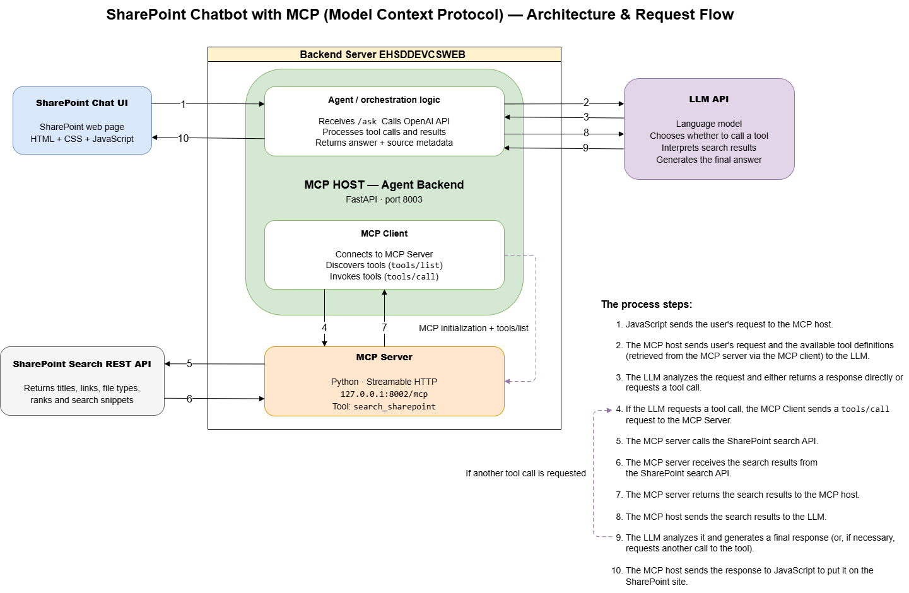

# MCP-based SharePoint chatbot

**Project**: The SharePoint chatbot uses a RAG architecture in which SharePoint Search retrieves relevant information from internal documents, and MCP is used to separate the AI agent app from the implementation that exposes SharePoint functionality.

**Consumer**: Contra Costa County Employment and Human Services Department, CA

**Program languages**: Python, JavaScript

**Python libraries are used**: requests, json, HttpNegotiateAuth, CORSMiddleware, MCPServer, BytesIO, Document, PdfReader, load_workbook

**Description**: 
The chatbot lets users ask ordinary questions about information stored on the SharePoint site. It combines SharePoint Search Engine with MCP to connect any AI-agent and produce concise answers grounded in information retrieved from SharePoint.
MCP stands for Model Context Protocol. It defines a common protocol for communication between an AI application and external capabilities, such as data sources, APIs, and tools.

The chatbot workflow:
1. JavaScript sends the user's request to the MCP host.
2. The MCP host sends user's request and the available tool definitions (retrieved from the MCP server via the MCP client) to the LLM.
3. The LLM analyzes the request and either returns a response directly or requests a tool call.
4. If the LLM requests a tool call, the MCP Client sends a tools/call request to the MCP Server.
5. The MCP server calls the SharePoint search API.
6. The MCP server receives the search results from the SharePoint search API.
7. The MCP server returns the search results to the MCP host.
8. The MCP host sends the search results to the LLM.
9. The LLM analyzes it and generates a final response (or, if necessary, requests another call to the tool).
10. The MCP host sends the response to JavaScript to put it on the SharePoint site.

The project file structure:
 - agent_backend
    - main.py - agent backend script
 - mcp_server
   - server.py - MCP server script 
 - ChatBotMCP.html - frontend JS-script and HTML chatbot web interface

**Results / Key Findings:** The chatbot connects artificial intelligence to the organization’s knowledge base to provide accurate answers based on up-to-date company documents, rather than just the neural network’s collective memory. 

**Illustrations**: Workflow diagram

You can view examples of chatbot questions and answers in the previous project [here](https://github.com/dmitrii-govorukhin/RAG-based_SharePoint_chatbot/blob/main/README.md).
